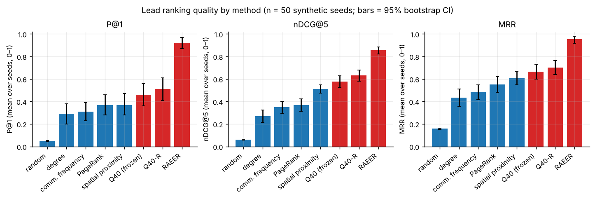
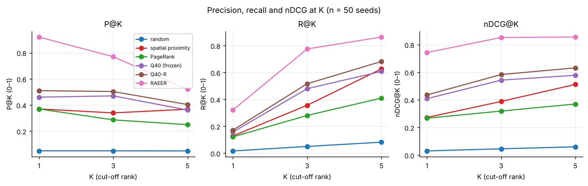
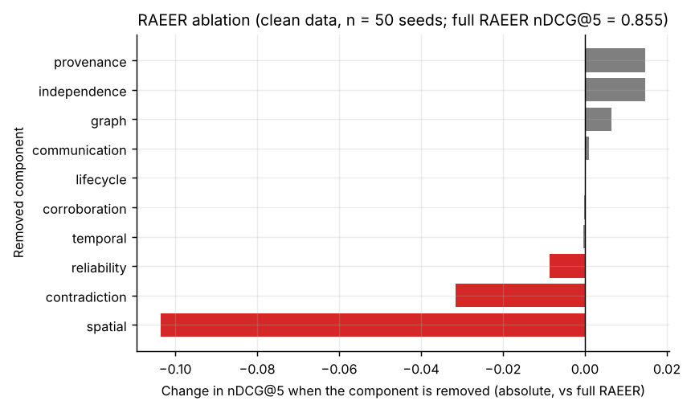
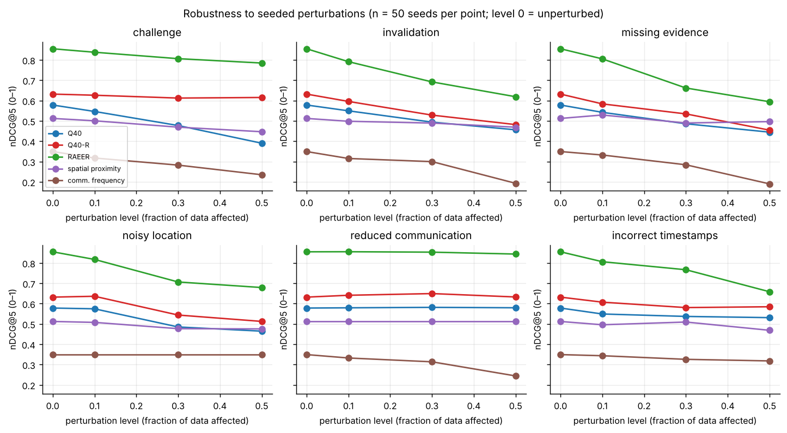
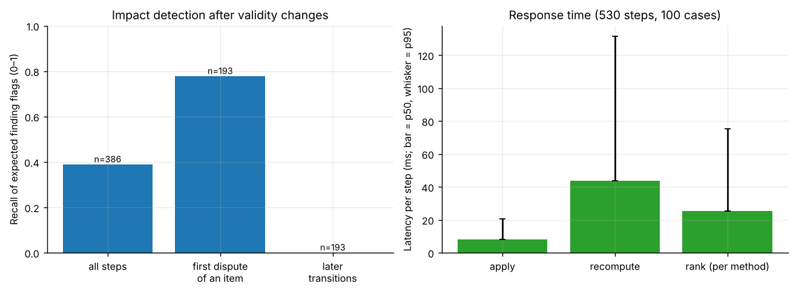
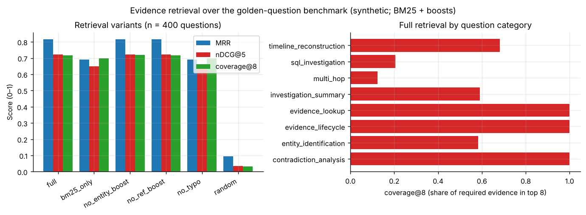
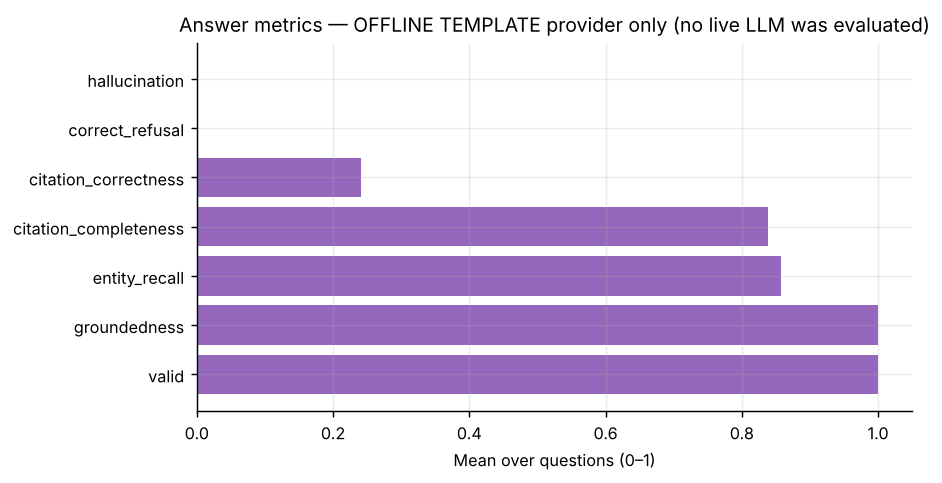
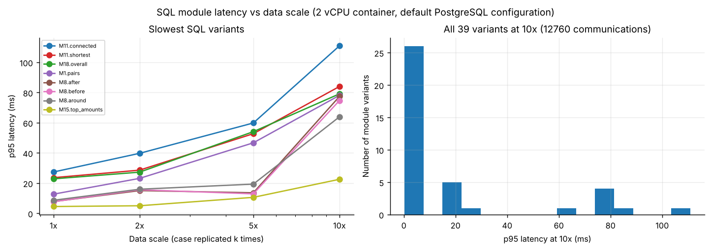
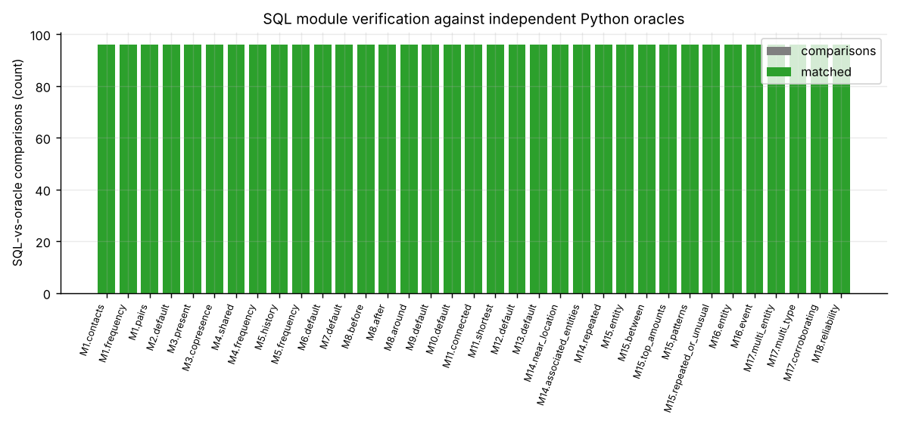

# Figure index

All figures are generated by `python -m research.phase8.plots` from stored results (no hand-entered numbers).

## Ranking comparison

*Caption.* Seed-level means (each seed = mean of its 2 cases). Red bars: Q40 family. Synthetic data; see Section 'Threats to validity' for generator coupling.
*Source:* `phase3/results/<latest>/aggregate_metrics.csv; phase4/results/<latest>/aggregate_metrics.csv`

## Metrics at K

*Caption.* Precision falls and recall rises with K as expected; relevant = perpetrator or accomplice.
*Source:* `phase3/4 aggregate_metrics.csv`

## Ablation

*Caption.* Negative = component helps. Most components show no detectable effect on clean data; spatial and contradiction handling matter most.
*Source:* `phase5/results/<latest>/analysis.json (ablation.clean.means)`

## Robustness

*Caption.* Six of 13 perturbation types shown; all 13 are in the Phase 5 report. Level 0 is the clean run.
*Source:* `phase5/results/<latest>/analysis.json (robustness, robustness_clean)`

## Evidence evolution

*Caption.* Expected-flag recall is measured against independently authored three-tier expectations; the 0 recall at later transitions is discussed in the Phase 5 report.
*Source:* `phase5/results/<latest>/evolution_analysis.json`

## Retrieval

*Caption.* Typo-tolerant matching accounts for the gain over plain BM25 here; entity and reference boosts had negligible effect. Multi-hop and SQL-investigation questions are weakest.
*Source:* `phase6/results/<latest>/analysis.json`

## Answer metrics (template provider)

*Caption.* Template answers restate retrieved records, so groundedness is high and hallucination zero by construction; correct refusal is 0 because the template never refuses. No LLM provider result exists.
*Source:* `phase6/results/<latest>/analysis.json (answer.ALL)`

## SQL scalability

*Caption.* Synthetic replication model; indicative only. p95 over repeated executions.
*Source:* `phase7/results/<latest>/scalability.json`

## Oracle agreement

*Caption.* Green fully covering grey = every comparison matched (after the two defects found by this phase were fixed).
*Source:* `phase7/results/<latest>/oracle_summary.json`
